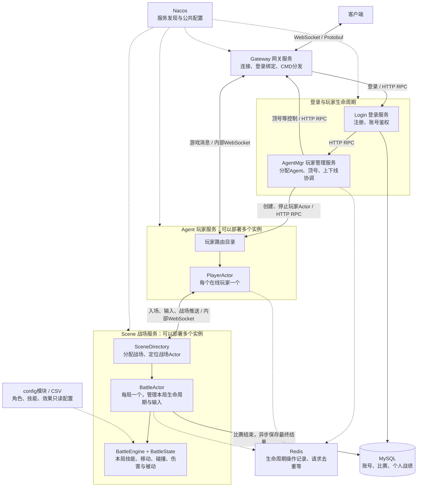
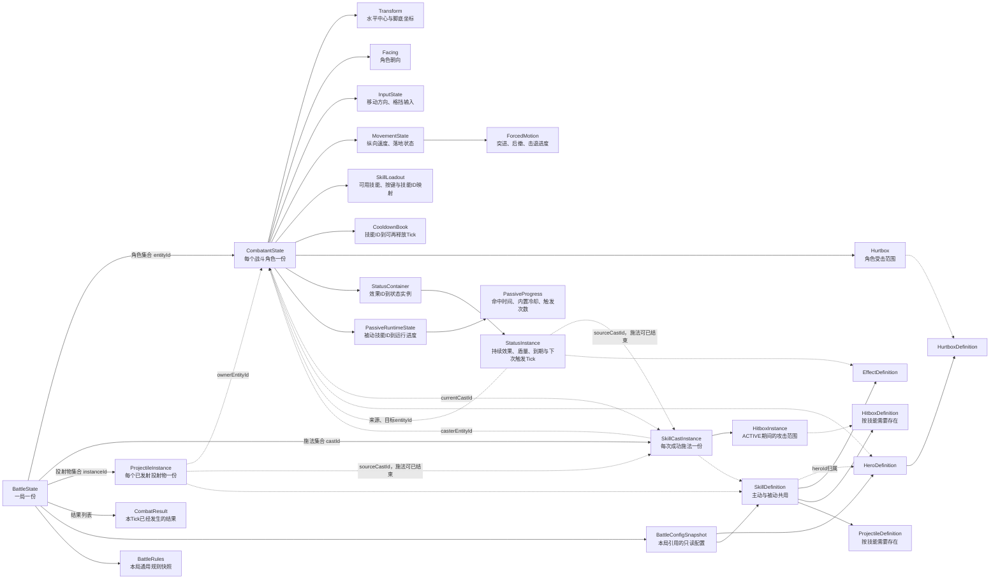
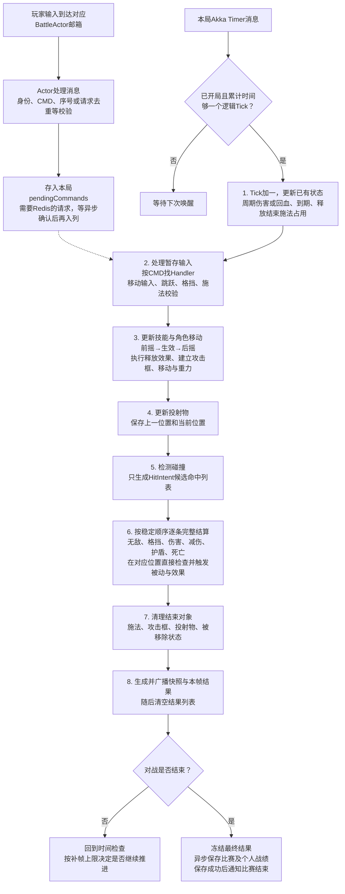

# Ninja Arena 项目架构、技能实体与主循环

本文按当前项目实现整理；节点管理模块 nodemgr-server 已删除。图中的输入暂存和结果记录不是战斗事件执行队列。

## 1. 项目架构图

这里的连线表示职责和消息方向，不代表每条输入都会经过所有服务。

- 登录路径：客户端 → Gateway → Login → AgentMgr → Agent 创建 PlayerActor，成功后把玩家路由绑定到网关连接。
- 战斗路径：客户端 → Gateway → Agent / PlayerActor → 指定 Scene → 指定 BattleActor。
- 返回路径：BattleActor → Agent / PlayerActor → Gateway → 客户端。
- AgentMgr 负责玩家生命周期，不负责每一帧的战斗计算；Nacos 负责发现服务，不替每条战斗输入重新选服务器。
- 入场后固定 Scene 实例和战场；后续输入沿原路由进入同一个战场。

公共模块不是独立进程：game-common 放 CMD、Handler 注册及公共工具；game-protocol 放 Protobuf 协议；game-core 放复用的 Actor 和内部网络接入；config 放 CSV 及只读配置。

## 2. 技能系统实体关系图

实线表示持有或管理；虚线表示配置引用或通过 ID 关联。图中包含实体、状态容器和值对象，它们不是一一对应数据库表。

关键关系：

| 对象 | 管什么 | 生命周期 |
|---|---|---|
| BattleState | 本局全部战斗运行状态 | 一局 |
| CombatantState | 角色 HP、蓝量、防御值、位置、技能栏、状态和被动 | 本局角色 |
| SkillCastInstance | 一次施法的前摇、生效、后摇、命中记录 | 一次施法 |
| HitboxInstance | 近战等攻击的判定范围 | 施法生效期 |
| ProjectileInstance | 飞镖位置、飞行进度和来源 | 发射到碰撞或射程结束，可长于施法 |
| StatusInstance | 中毒、流血、回血、护盾、减伤、无敌等持续效果 | 生效到到期、消耗完或被移除，可长于来源施法 |
| PassiveProgress | 某一个被动的计数、内置冷却、触发次数 | 跟随角色 |
| CombatResult | 已发生的伤害、施法、被动等结果 | 当前 Tick，构建推送后清空 |

没有 PassiveDefinition：被动读取 SkillDefinition 和 EffectDefinition。ProjectileDefinition 是技能内的配置，不需要单独 projectile.csv。

HitIntent 是碰撞阶段生成的本帧候选命中记录，由后续结算阶段读取；DamageResult 是一次伤害的返回值，Aabb 是碰撞矩形。它们是过程数据，不需要作为长期存活的实体管理。各 Processor、EffectExecutor、BattleEngine 是处理逻辑，不是角色实例。

角色之间通过 entityId 关联；userId 标识账号，heroId 标识角色配置，skillId 标识技能配置，castId 标识本局的一次施法。castId 与 battleId 共同定位施法，不能代替 requestId 做请求去重。

## 3. 主循环逻辑图

每局一个 BattleActor，由它自己的 Akka Timer 唤醒。Timer 消息和输入消息都由该 Actor 串行处理；多局可由共享调度线程池并行运行，不是一局独占一个线程。

默认逻辑频率为 30Hz，每 Tick 约 33.3ms。约 10ms 的 Timer 唤醒用于检查累计时间，不代表每 10ms 推进一帧。累计时间够一个逻辑步长才推进 Tick，落后时有界补帧。

八个阶段在同一个 Tick 内按顺序执行；没有工作时，该阶段内部跳过具体处理。周期伤害在第1阶段就会直接结算，不是所有扣血都必须等第6阶段。第6阶段负责本帧碰撞产生的命中。

执行当前 Tick 时，后来到达的输入只能先等在 Actor 邮箱。Actor 处理它、完成必要的异步校验并存入 pendingCommands 后，在后续 Tick 的第2阶段执行，不能插进当前帧。

当前采用顺序结算：前一次伤害触发的护盾立刻影响后一次伤害；前一个命中杀死某角色，后面的近战命中可能因此取消。稳定顺序以来源角色等 ID 排序，不保证同时互杀，也不等于公平性已解决。

## 4. 广播如何实现

当前广播范围是本局成员。每个正常推进的逻辑 Tick 在结束时构建一份完整快照，再按成员所在的 Agent 实例分组发送。

例如本局 A、B 都在 Agent-1：Scene 向 Agent-1 发送一条消息，列出 A、B 两个接收者；Agent 分别投递给两个 PlayerActor，再各自转发到玩家当前 Gateway 和客户端连接。若 A、B 在不同 Agent，Scene 分别向两个 Agent 发送。当前分组发生在 Scene→Agent 这一段，不表示后续每段网络发送都会合并。

快照包含：战场 ID、serverTick、角色位置与朝向、HP/蓝量/防御值、存活、施法阶段、持续状态、投射物，以及本 Tick 已发生的战斗结果。当前不是差量同步，也没有视野 AOI 广播。

广播传的是已经结算的结果，不会在 PlayerActor、Gateway 或客户端再扣一次血。Protobuf 中名为 CombatEvent、SceneToAgentEvent 的消息是传输数据，不是待执行的战斗事件队列。

| 类型 | 发给谁 | 内容 |
|---|---|---|
| 命令响应 | 发起者 | 施法是否成功、错误原因、castId 等 |
| 战斗广播 | 本局所有成员 | 权威状态快照与本帧结果 |
| 比赛结束通知 | 本局成员 | 已确认保存的最终比赛结果 |

网络发送由 Netty 异步完成，战场不等待玩家收到才推进下一 Tick。但这不代表可靠送达：当前快照和本帧结果没有逐条客户端确认、持久化或补发。一次快照未送达，后续完整快照能提供更新状态；一次性的伤害飘字等表现结果不保证重放。内部链路恢复有快照重同步，也不能等同于玩家断线后恢复原战局。

## 5. 关键机制，用业务逻辑理解

| 机制 | 当前如何处理 | 解决什么问题 |
|---|---|---|
| CMD分发 | 每层按 CMD 查已注册的 Handler；CAST_SKILL 再用 skillId 读取配置 | 不为每个技能增加网络命令或一串技能ID判断 |
| 权威状态 | 客户端发操作意图；Scene 决定位置、技能是否合法、命中和伤害 | 不信任客户端上报伤害或最终位置 |
| Actor隔离 | PlayerActor 管玩家会话与路由；BattleActor 独占本局战斗状态 | 不让不同线程同时修改同一局数据 |
| 异步回到邮箱 | Redis等异步操作结束后，需修改 Actor 状态的步骤重新进入邮箱 | 异步执行期间仍保持状态访问串行 |
| 请求去重 | 请求窗口合并重复等待者，Redis记录请求状态和结果；重试沿用原请求 | 网络重发不重复扣蓝、开始冷却或创建施法 |
| 移动序号 | 移动输入使用递增 clientSequence，过旧序号不覆盖新方向 | 防止旧方向消息覆盖后来的输入；不代表全局统一排序 |
| 旧消息隔离 | 校验玩家Actor、Scene实例、战场与入场操作身份 | 避免已离场或旧登录的消息修改当前战场 |
| 冷却与时间 | 保存可再次施法Tick、状态结束Tick和周期触发Tick | 不必每帧把所有冷却数值逐项减一 |
| 碰撞与重复命中 | 攻击框对受击框；投射物检测一帧飞过的路径；施法记录已接触目标entityId | 避免飞得快穿过目标，以及同一次攻击连续多帧重复命中 |
| 伤害与被动 | 本次伤害内算减伤和已有护盾；扣血后立即检查阈值被动；有效命中后立即更新命中被动 | 后续命中读到包含新护盾等变化的最新状态 |
| 配置隔离 | CSV加载校验后形成只读配置；本局持有配置和规则快照 | 避免比赛中途规则变化；配置不是数据库运行时实体 |
| 结算持久化 | 比赛结束后冻结结果，比赛与个人战绩同事务保存，重复保存核对结果 | 避免一局只存了一半或重复记战绩 |
| 资源回收 | 每Tick删结束的战斗对象；目录定期检查并回收可关闭的空战场Actor | 避免技能对象和空战场长期占内存 |

requestId 负责一次请求与重试；castId 负责一次施法；cmd 负责消息类型；skillId 负责技能配置，这四个不能混用。

## 6. 当前边界

- 没有 BattleEventQueue。Actor邮箱、pendingCommands、HitIntent列表、combatResults列表各有用途，不是延迟执行伤害/被动的统一队列。
- 当前客户端推送每Tick是全量快照，未增加差量、AOI、客户端预测或回滚机制。
- Actor之间依赖共享线程池调度；一次长任务仍会占用线程，异步网络发送也仍有组包、序列化及缓冲成本，不能理解成无限吞吐。
- 当前没有战场进程崩溃恢复；Redis请求去重不代表已经持久化全部战斗状态。不能承诺跨进程故障下的严格恰好执行一次。
- 当前 AgentMgr 按单实例仲裁设计，不能仅靠 Nacos 注册多个实例就认为生命周期管理可安全横向扩展。
- 三个MySQL表是 game_account、game_match、game_match_result；技能、状态、投射物、被动进度等不建运行时表。
- 地图/跳跃已配置首版数值并发布到Nacos的prod-Ninja命名空间，见`config/nacos/README.md`；CSV中的普攻配置仍需补齐，真实基础设施全链路尚未联调。
